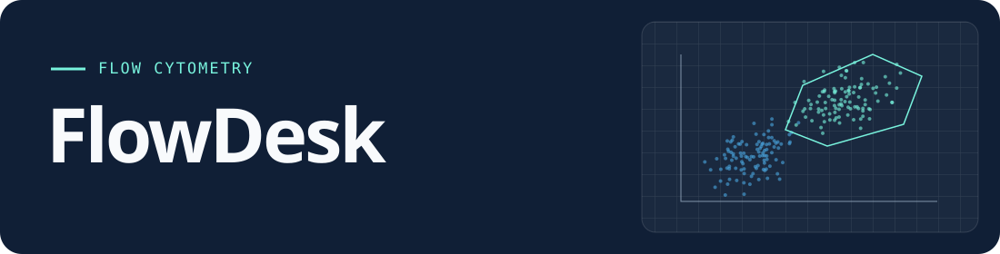

<div align="center">
  
  <p>Open FCS files, draw gates, and compare population statistics in one desktop workspace.</p>
  <p><a href="#try-the-demo"><strong>Try the demo</strong></a> · <a href="#run-flowdesk">Run FlowDesk</a> · <a href="https://github.com/ArdaOdabas/flowdesk/releases">Releases</a></p>
</div>


<p align="center"><sub>The built-in T-cell demo shows two synthetic tubes, their gates, and the resulting population statistics.</sub></p>

## From FCS files to population statistics

1. **Open your tubes.** Import FCS 3.1 or `.lmd` files. Use the embedded spillover matrix or adjust compensation by hand. Switch between linear and biexponential scaling.
2. **Build a gate tree.** Draw polygon, rectangle, and quadrant gates. Save the strategy as a template and apply it to other tubes.
3. **Review and export.** Compare event counts, frequencies, and medians by population. Export CSV, PNG, or FCS.

## Try the demo

Select **Load demo data** to explore two synthetic tubes. Click a population in the gate tree to see its plots and statistics.

## Run FlowDesk

<details>
<summary>Run from source with Node.js and npm</summary>

```sh
git clone https://github.com/ArdaOdabas/flowdesk.git
cd flowdesk
npm install
npm start
```

</details>

MIT · [Licence](LICENSE) · [Third-party notices](NOTICE)
