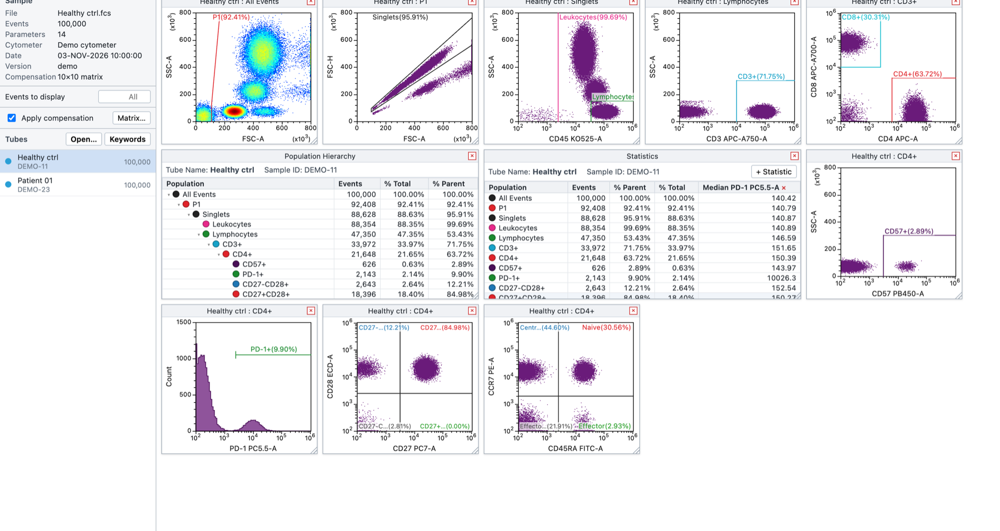

<div align="center">

# FlowDesk

**A desktop workspace for flow cytometry analysis.**
Open FCS files, gate them, compensate them, and export the numbers — entirely on your own machine.

</div>



---

## Why

Flow cytometry analysis usually means a licence seat, a login, and your raw data living on someone
else's server. FlowDesk is a small desktop application that opens an FCS file, lets you build a
gating strategy, and gives you the statistics back. Nothing is uploaded, nothing phones home, and
the file you opened is never modified.

## What it does

| | |
|---|---|
| **Reads FCS 3.1 and `.lmd`** | An independent implementation of the specification published by ISAC |
| **Gates** | Polygon, rectangle and quadrant gates, organised into a population hierarchy |
| **Compensation** | From the spillover matrix stored in the file, or edited by hand |
| **Transforms** | Biexponential and linear scaling for fluorescence channels |
| **Statistics** | Per-population counts, frequencies and medians, with columns you choose |
| **Templates** | Save a gating strategy once and reapply it to every other tube |
| **Export** | CSV, PNG and FCS, through the system save dialog |

Open the application and press **Load demo data** to see the whole workflow with two synthetic
tubes before you point it at anything of your own.

## Install

Requires [Node.js](https://nodejs.org/) and npm.

```sh
git clone https://github.com/ArdaOdabas/flowdesk.git
cd flowdesk
npm install
npm start
```

## Build a standalone application

```sh
npm run dist:mac    # macOS, universal
npm run dist:win    # Windows, x64
npm run dist:dmg    # macOS disk image
```

The packaging scripts expect `build/icon.icns`, `build/Info.extra.plist` and `build/make_dmg.sh`.
Those are not in this repository: add your own icon and packaging metadata, or drop the `--icon`
and `--extend-info` flags from the scripts in `package.json`.

## Your data stays yours

The renderer runs with `contextIsolation` and `sandbox` enabled and no Node integration; the preload
bridge exposes only what the interface needs. Links open in the system browser rather than inside
the application. FCS files are read from disk and parsed locally — there is no network code in the
analysis path at all.

## Licence

MIT — see [LICENSE](LICENSE). The relationship to the FCS standard and to other cytometry software
is set out in [NOTICE](NOTICE).
